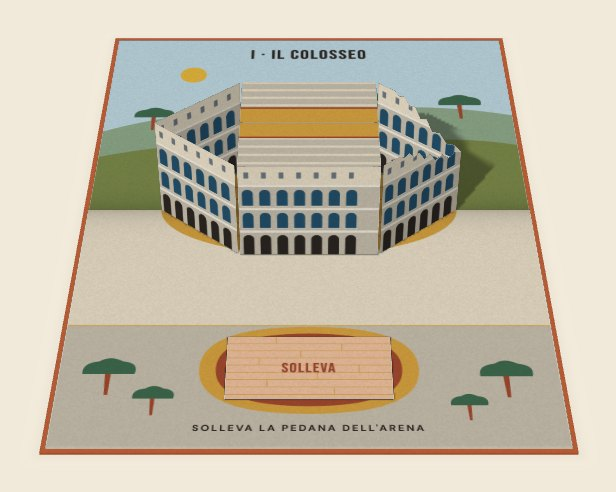
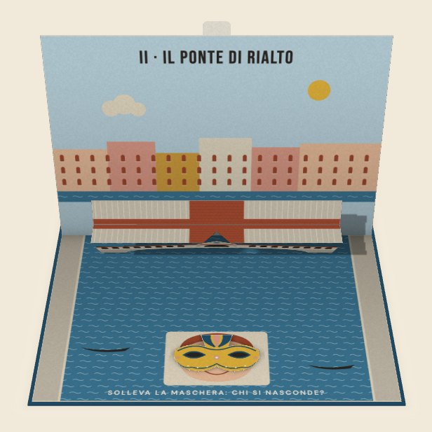
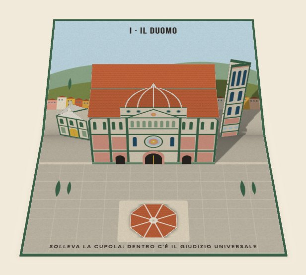
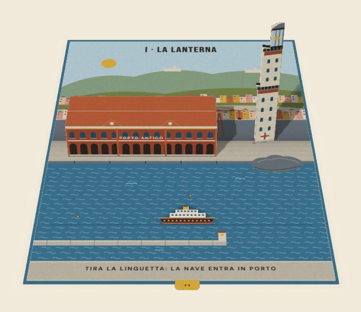
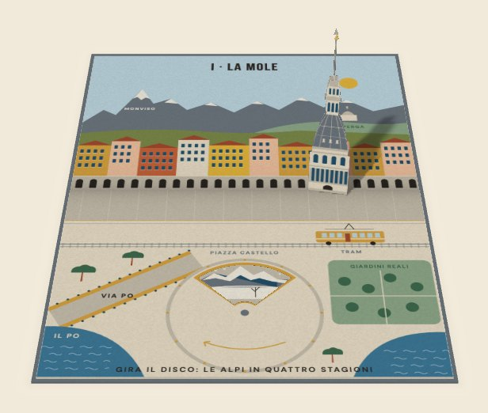
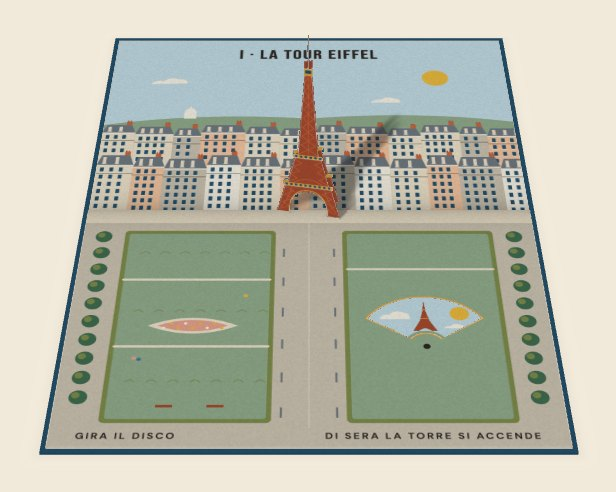
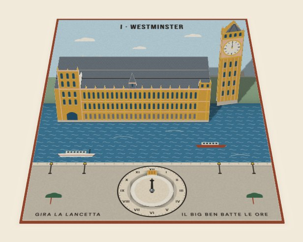

# Pop-up di carta

Una skill per Claude Code che trasforma una riga di testo in un libro pop-up di carta: un solo file HTML che si apre, si sfoglia e ha qualcosa da toccare in ogni pagina.

**[Sfoglia gli otto libri d'esempio](https://paolobortolotti.github.io/popup-carta/)**

| | |
|---|---|
|  |  |
| **Roma**: il Colosseo con l'arena da scoperchiare, San Pietro, una Vespa davanti a Trevi. | **Venezia**: una gondola sul Canal Grande, Rialto, l'orologio di San Marco. |
|  |  |
| **Firenze**: dentro la cupola del Duomo, i canottieri sotto Ponte Vecchio, il giorno e la notte dal Piazzale. | **Genova**: una nave che entra in porto sotto la Lanterna, il portone di un palazzo dei Rolli, il cielo su Boccadasse. |
|  |  |
| **Torino**: le stagioni sulle Alpi dietro la Mole, un caffè storico sotto i portici, una barca sul Po. | **Parigi**: la Tour Eiffel dal giorno alla notte, un battello sulla Senna, il telo di un pittore a Montmartre. |
|  |  |
| **Londra**: un orologio da girare a Westminster, un bus verso Tower Bridge, la metro sotto la strada. | **Tokio**: l'omikuji di Asakusa, Shibuya che si accende di sera, uno shinkansen verso il Fuji. |

Le otto città sono esempi. Per un altro luogo si cambia la descrizione, non il codice: città, borghi, hotel, negozi, eventi.

## Installa

Servono [Claude Code](https://claude.com/claude-code) e Node.js (`node -v` nel Terminale ti dice se c'è).

1. Apri il Terminale e incolla:
   ```bash
   git clone https://github.com/paolobortolotti/popup-carta ~/.claude/skills/popup-carta
   ```
2. Riavvia Claude Code: legge le skill all'avvio.
3. Chiedi un libro, a parole o con `/popup-carta`:
   > un libro pop-up di Napoli, con il Vesuvio e il golfo

   Claude salva un file `.html` nella cartella in cui lavori: aprilo con un doppio clic.

Senza git: scarica lo [zip](https://github.com/paolobortolotti/popup-carta/archive/refs/heads/main.zip), aprilo e sposta la cartella:

```bash
mkdir -p ~/.claude/skills && mv ~/Downloads/popup-carta-main ~/.claude/skills/popup-carta
```

Per aggiornare: `git -C ~/.claude/skills/popup-carta pull`. Per togliere: cancella `~/.claude/skills/popup-carta`.

## Come funziona

Claude non scrive codice di disegno. Scrive la scena in un JSON (cosa si alza dalla pagina, cosa è dipinto, cosa si tocca) e un motore fisso la disegna. Prima della consegna un validatore apre e chiude il libro e prova ogni piega come su carta vera: se un pezzo sporge dal libro chiuso o ne urta un altro, dice quale e di quanti millimetri.

Sei meccanismi, presi dai libri pop-up veri:

| Meccanismo | Cosa fa |
|---|---|
| Facciata | piega parallela alla costola: palazzi, ponti, file di case |
| Gradoni | pieghe annidate che scendono verso chi legge: terrazze, scalinate |
| Torre | piega a V sulla costola: campanili, fari, la Mole |
| Linguetta | si tira dal bordo e qualcosa attraversa la pagina |
| Sportello | si alza e mostra cosa c'è sotto o dentro |
| Ruota | si gira e cambia la scena: l'ora, la stagione, il giorno e la notte |

Il libro esce come pagina intera oppure come blocco da incollare in una pagina esistente, che prende la larghezza del contenitore.

## Cosa c'è dentro

| Percorso | Contenuto |
|---|---|
| `SKILL.md` | le istruzioni che segue Claude |
| `engine/` | il motore (JavaScript, WebGL2), lo stile e i due font |
| `schema/scene.schema.json` | il formato della scena, con ogni meccanismo descritto |
| `examples/` | le scene dei libri d'esempio, che Claude legge come riferimento |
| `build/build.sh` | controlla la scena e monta il file HTML |
| `tests/kinematics.test.mjs` | il controllo delle pieghe |
| `docs/` | la vetrina pubblicata su GitHub Pages (`node build/site.mjs` la rigenera) |

Tutto testo in chiaro, nessuna dipendenza da installare. All'installazione non parte niente. I libri girano nel browser, con motore e font dentro il file: nessuna richiesta esterna, nessun tracciamento.

Testata in Claude Code su macOS. Non è stata provata su claude.ai, né misurata su un telefono di fascia media.

## Licenza

Codice con licenza [MIT](LICENSE). I font Bebas Neue e DM Sans sono distribuiti con la SIL Open Font License 1.1 (`engine/fonts/`). I libri che crei sono tuoi.
